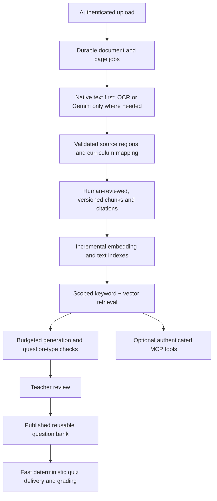

# AI pipelines, RAG and MCP audit — 20 October 2026

Historical audit baseline: commit `fb711674adad1f73b9bb264bda2e10adcd1c6129`, before implementation. Line references below describe that revision. At that audit stage no real Gemini requests or production writes had been made. For subsequent fixes, live synthetic verification, explicit limits and release steps, see [AI trust implementation](AI-TRUST-IMPLEMENTATION-2026-10-21.md).

## Assessment

There are useful foundations: authenticated asynchronous jobs, grading isolated from AI work, structured output validation, server-owned scores, frozen assessments, source IDs in the TypeScript generation audit, and mandatory educator review for generated drafts. However, the website's TypeScript generator, Python document ingestion, and Python knowledge/validation packages are separate implementations with incomplete connections. The complete RAG architecture described in comments is not the execution path of the website's generator.

The owner confirmed that the 5–10 keys belong to separate accounts and projects. Quotas must still be measured and scheduled per project and model, rather than assuming capacity from the number of keys. Multiple credentials for one project share that project's quota. Use approved project quotas; rotation is not an unlimited-capacity mechanism.

## Findings, ordered by urgency

| Priority | Finding and evidence | Consequence and improvement |
|---|---|---|
| Critical | `services/ingestion/pipelines/past_paper_pipeline.py:459–523` logs a source-text mismatch but continues to insert `verified=true` and `ai_verified=true`. `services/ingestion/stages/gemini_extractor.py:552` supplies a fixed confidence of 0.98; page conversion supplies 0.98/0.99 values. | Confidence and verification do not establish academic correctness. Store extraction status, source evidence, automated checks and human approval separately. Fail uncertain items into review; retain the original document/page/crop. Audit existing content produced through this path before using it as authoritative evidence. |
| Critical | `past_paper_pipeline.py:525–565` looks up SLO codes without board/class/version scope and can infer a unit from question number, then select an arbitrary SLO within that unit. Syllabus ingestion defaults to Physics and a hard-coded 2025–2028 version. | Weak-topic scores, recommendations and RAG context can look plausible while using the wrong curriculum. Require exact board/class/subject/version filters and evidence-based mapping; keep unknown mappings unknown. |
| High | `services/knowledge/retrieval.py:184–309` omits class/subject filtering in parts of keyword retrieval; the vector backend contract accepts no curriculum/owner scope. The concept graph's past-paper loop also lacks class/subject checks. | Offline reproduction returned a Class XII Chemistry source to a Class IX Physics query. Apply scope before every retrieval strategy and ranking, including access controls on private teacher material. Never relabel a hit with the requested scope. A second offline reproduction returned an unverified AI-inferred textbook mapping even with include_ai_generated=False: the keyword textbook path also needs the verification/trust filter. |
| High | `services/knowledge/pgvector_client.py:150` has no real PostgreSQL backend implementation: construction without an injected backend leaves semantic search unavailable. CurriculumStore and TextbookMapper are in-memory stores. | Installing pgvector does not make this reusable retriever operational. Implement a persistent backend and startup wiring; distinguish disabled retrieval from a genuine search with zero matches. A separate SLO classifier contains vector SQL, but it does not complete the shared retrieval service. |
| High | `services/ai/generate.ts:42–61` fetches up to 80 SLOs and 12 linked book passages, without relevance ordering or semantic/keyword ranking. Each passage is truncated at 4,000 characters. | The live code path is evidence-constrained generation, not the full hybrid RAG implementation. Rank relevant chunks, diversify evidence and budget context by tokens. Preserve equations, tables, diagram references and neighbouring context. Return precise citations, not just a generation-level list of source IDs. |
| High | Textbook jobs in `scripts/job-worker.ts:25–26` invoke the CLI without upload metadata. `ingest_*` region tables are separate from Prisma BookContent. `scripts/sync_books.py` is a standalone bridge, not called by that job; it also creates content without SLO links and is not idempotent for existing content rows. | A successful extraction need not produce usable generation evidence. Add a transactional, idempotent canonicalization/mapping/index stage and report extraction, indexing and readiness separately. |
| High | `services/ingestion/pipeline.py:203` calls `GeminiKeyPool.is_all_exhausted()`, which does not exist. The pipeline marks a document completed after its page loop even when page errors occurred. Existing hashes are skipped before checking completeness. | Failure recovery and advertised next-day resumption are not reliable. Use persisted page states, terminal PARTIAL/FAILED/WAITING_QUOTA statuses, an actual resume entry point, and completion only when all required stages succeed. |
| High | `services/inference/gemini_client.py:145–180` treats exhaustion as a 25-second cooldown, including authentication failures. Limits are per-key and process-local; advertised TPM enforcement is absent. Timestamp lists retain expired entries in storage. Locks are held during sleeps. | Daily quota exhaustion can cause repeated failed calls; multiple workers can oversubscribe a project; independent keys block each other while sleeping. Persist project/model RPM/TPM/RPD budgets, honour provider retry information, disable invalid credentials, release locks before waiting, and reschedule jobs rather than occupying workers. |
| High | `services/ai/generate.ts:19` truncates the key list to three entries. Python and TypeScript clients implement unrelated retry/rotation rules. Python permits at least 15 key-selection rounds per model and creates new HTTP clients repeatedly. Job retries can repeat provider attempts. | Five to ten configured keys do not all participate in the TypeScript path. Consolidate provider policy, pool reusable connections, cap request/job deadlines and total attempts, record usage, and prevent retry multiplication. Distinguish permanent input/auth/model errors from transient overload. |
| High | `services/ingestion/stages/pdf_extraction.py` renders all pages into an in-memory list; `pipeline.py:148` does this before slicing to max_pages. The configured render DPI is 300. | Roughly 25 MiB of RGB image memory per A4 page at 300 DPI means 100 pages can occupy about 2.4 GiB before other buffers, OCR, web and database memory. Stream pages, enforce limits before rendering, and use lower-DPI/native text first with targeted high-resolution crops. Start with one memory-limited ingestion worker on the current 4-vCPU/8-GB host. |
| High | `Dockerfile.assessment-worker:16` defaults to EXAM_FINALIZE/EXAM_GRADE and explicitly excludes Python/OCR runtimes. The repository's generic worker supports AI/ingestion, but a consumer and its dependencies must be deployed separately. TypeScript generation also requires GEMINI_MODEL/GEMINI_MODELS. | Keys alone cannot process AI jobs. Verify dedicated AI and ingestion consumers, dependencies, migrations, model configuration and readiness before enabling uploads/generation. Do not put long OCR work into the grading worker. Runtime AI-worker availability was not re-inspected in this audit. |
| Medium | Python PgVectorClient defaults to 1536 dimensions while Prisma columns and Gemini embedding calls use 768. Some classifier code uses Ollama embeddings. Dimension mismatch only logs a warning. Embedding text is sliced to 2,048 characters. | Same-size vectors from different models are not interchangeable. Record and enforce embedding model/version/dimension/task type, reject mismatches, retain chunk hashes and re-embed versioned namespaces. Chunk before embedding instead of silently cutting off text. |
| Medium | Custom paper/syllabus uploads return before the comprehensive runner's embedding stage (`unified_runner.py:341`). Embedding failures are swallowed. No HNSW/IVFFlat index is defined in the checked-in Prisma migrations. | Uploaded material can remain unindexed without a visible readiness failure. Queue incremental embedding jobs, expose index coverage, add a tested vector index and filtered-query benchmarks when corpus size justifies it. |
| Medium | Metadata retrieval rebuilds the concept graph on each query; keyword retrieval scans Python collections using Jaccard overlap. Source authority is the primary sort regardless of query relevance. | This does not scale with a large corpus and can promote authoritative but irrelevant passages. Use indexed PostgreSQL full-text search plus vector search, strict relevance eligibility, rank fusion, diversification and a bounded reranker where useful. Retain authority as a quality gate/prior. |
| Medium | The TypeScript verifier uses the same model-selection function as generation and compares only the first correct option. Its verification prompt omits correctAnswerText/rubric metadata needed for some subjective tasks. It does not fully assess multiple-answer correctness. | Same-model agreement is not independent proof. Use question-type-specific validation: set comparison for multi-select, numerical tolerance/unit checks, separate subjective review, and alternate solver/model where available. Keep educator approval even when models agree. |
| Medium | Review items are persisted before the final generation audit, and the final audit is not deduplicated by job. Input hashes exclude source versions/model/prompt changes. Python exports ignore subprocess failure (`check=False`) and generated cache files may live outside the shared asset mounts. | Retried/partial jobs can produce inconsistent audit records or stale frontend data. Use stage-level idempotency, source-aware cache keys, explicit export failures and durable artifact publication/invalidation. |
| Medium | `scripts/job-worker.ts:29` discards child stdout/stderr and records generic failures. There is no end-to-end AI usage/quality dashboard in this path. | Debugging ingestion or quota failures is difficult. Keep redacted structured logs keyed by job/stage/document/page/project/model, plus tokens, latency, retries, queue age, indexing coverage and review rejection rate. |
| Medium | `services/generation/pipeline.py:stage_to_database` returns a mock draft ID. Several richer Python validators are not wired into the website's TypeScript generation path. Duplicate `*-DESKTOP-*` modules and board config files remain; offline tests log overwritten board profiles. | Passing module tests does not prove production integration. Retire obsolete implementations, make the production path explicit, add migration/integration tests and prevent duplicate configuration discovery. |

## Recommended architecture

Keep PostgreSQL as the launch-stage durable queue and knowledge store. There is no need to introduce a separate vector database simply because MCP or RAG is being added. Add bounded AI-generation and ingestion workers, separate from grading. Use a shared project/model quota scheduler in PostgreSQL initially; Redis is optional if measured coordination load warrants it. Pause low-priority indexing when service health or memory is under pressure.

An AI request should first try reusable approved content or an evidence-versioned cache. New content should be generated asynchronously and reviewed once, then served repeatedly. A quiz submission should not call Gemini. The earlier target of 20,000 concurrent submissions is a grading/load-testing problem, not an AI-key capacity target.

Measure effective requests/minute from both RPM and token throughput. For each project/model, a rough planning ceiling is min(RPM, TPM / mean input tokens), with daily quotas and actual output/latency constraints checked separately. Divide the available request budget by calls per workflow. This is a planning bound, not a measured throughput promise.

## MCP recommendation

MCP can expose existing services to an AI assistant through defined tools. It does not replace RAG, make missing embeddings searchable, fix academic correctness or enlarge provider quotas. The current repository has no MCP server implementation in the inspected application/services/dependencies.

Start with a small internal server exposing `search_curriculum`, `get_source_passage`, `get_slo`, and `create_quiz_draft`. Progress tools must be scoped to the authenticated student or a teacher's authorized classes. Publishing content, assigning a quiz and changing grades must remain normal authorized application actions, with explicit educator approval where applicable. Do not expose arbitrary SQL, shell execution, secrets or unrestricted student records. Treat uploaded documents and retrieved passages as untrusted data, not tool instructions. Set a maximum tool-call count and token budget per task.

Prefer an application-controlled MCP client/host that calls internal tools and shares only selected evidence with the model. Direct remote MCP is also documented by Gemini, but increases the importance of endpoint authentication, narrowly scoped tool access and bounded execution. Verify SDK/model/project support rather than assuming all free projects support every feature.

## Provider fit and free-tier limits

Official Google documentation says quotas are per project, not per API key, and cover RPM, input TPM and daily requests. Daily request quotas reset at midnight Pacific time. Actual allocations vary by model/project and must be read in AI Studio. Separate owner-confirmed projects can have separate budgets, but capacity is not a fixed multiple of key count and projects must operate within Google's applicable terms.

Google's current Gemini API terms also restrict clients directed at or likely to be accessed by under-18s. This matters for the site's school-age audience and requires provider/terms clarification before student-facing Gemini or MCP-assisted tutoring is rolled out. Do not assume changing billing alone removes that clause. The unpaid-service terms also say not to submit sensitive, confidential or personal information; human review and product-improvement use are described. Avoid sending named student histories, emails, private account data or confidential assessments through unpaid requests. Resolve the appropriate service/contract and minimize submitted data.

## Implementation sequence

1. Correct verification labels, curriculum scope, quota recovery and resumable document/page statuses. Add regression tests for the reproduced issues; audit previously auto-verified content without mass changing grades.
2. Deploy and verify dedicated bounded AI/ingestion consumers with redacted logs, clear readiness and shared project/model quota scheduling.
3. Connect textbook extraction to canonical, versioned, human-reviewed chunks and mapping/indexing. Add a real scoped PostgreSQL vector backend and consistent embedding namespaces.
4. Add retrieval evaluation and content-quality gates using real representative source pages/questions: cross-class/subject leakage, missing evidence, page citations, equations, diagrams, conflicting keys and refusal to invent.
5. Introduce cache/reuse, selective higher-cost verification and measured capacity dashboards. Add a narrow internal MCP server once the underlying services and provider eligibility are sound.

## Verification performed

- Existing offline Python knowledge, generation, validator and classification suites: **83 passed, 1 skipped**.
- Existing mocked TypeScript AI trust tests: **3 passed**.
- Additional in-memory reproduction: wrong-scope source returned; unverified AI-inferred mapping returned despite AI exclusion; default vector backend unavailable; and the referenced quota-exhaustion method missing.
- No live API calls, credential validation, real AI accuracy benchmark, production corpus inspection or load test was performed. The existing tests passing does not invalidate the reproduced gaps.

## Official references

- [Gemini rate limits](https://ai.google.dev/gemini-api/docs/rate-limits)
- [Gemini function calling and remote MCP](https://ai.google.dev/gemini-api/docs/function-calling)
- [Gemini API terms](https://ai.google.dev/gemini-api/terms)
- [MCP architecture](https://modelcontextprotocol.io/docs/learn/architecture)
