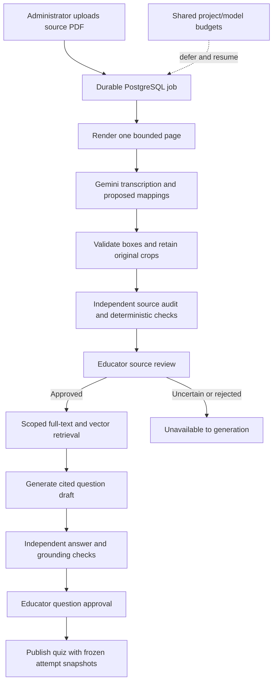

# Source-backed AI processing and review

This change replaces unsafe automatic publication with a durable extraction and review path. It does not claim that model agreement establishes academic truth.

## Implemented

- The website worker uses `services/ingestion/trusted.ts` and the bounded PDF-only Python renderer. Legacy direct-to-published paper imports, the destructive bundled importer, and unused data-wipe/rebuild commands are retired compatibility entry points. Their old implementations remain in Git history. Existing published questions and assessment attempts are preserved.
- Every source is scoped to a real board, class, subject and syllabus. Source hashes and immutable per-page review records identify the original evidence. Answer-key candidates are processed separately and linked with foreign keys; their official status is not inferred from a filename or upload setting.
- AI proposes normalized figure boxes, labels, connections, chemical bonds and curriculum mappings. Box validation rejects non-finite, inverted, out-of-range, tiny and full-page boxes. Each figure gets a separate stored asset. There is no first-15-pages cutoff. Rotated-page and extreme-page fixtures exercise the renderer.
- Separate-model source checks record conflicts without invented confidence scores. Chemistry checks cover atom conservation for a deliberately limited grammar, including ordinary coefficients, parentheses, state symbols and Unicode subscripts. Unsupported ionic/LaTeX notation remains subject to review; balanced atoms do not establish a valid reaction or bonding structure.
- `/admin/knowledge` shows the original page, original crops, structured region editing, searchable curriculum choices, conflicts and approval notes. Approved sources can be rejected or reopened. Every state transition is audited; stale reviews fail. The review interface was checked at 390px in light and dark themes.
- Production retrieval uses PostgreSQL full-text search and pgvector HNSW, with exact board/class/subject/version and approval filters. Embeddings are normalized, 768-dimensional, model-scoped and tied to the content hash. Unavailable semantic search preserves approved lexical retrieval. Unreviewed legacy `BookContent` is no longer authoritative generator evidence.
- Generated questions must cite retrieved source IDs. Source hashes, pages and model identities are retained. Independent checks cover grounding and SLO alignment; objective comparison uses the complete multi-select set and numerical tolerance. Written responses require educator judgment. Approval/publication checks revalidate the source status, hash and scope.
- PostgreSQL reserves shared project/model RPM, estimated input TPM and RPD budgets across workers. All configured credentials are available. Invalid credentials are disabled, missing models fail promptly, provider cooldowns defer jobs without consuming failure attempts, and daily budget windows use Pacific midnight including daylight-saving changes. These internal caps do not replace the provider's actual quotas.
- Explicit re-analysis creates a new source review revision; approving it supersedes the older transcription of the same page and syllabus. Extraction and generation checkpoints preserve work across deferred retries. Worker heartbeats make production admission reject AI work when its consumer is offline. Assessment and AI jobs cannot share a production worker. Administration health reports active worker kinds, source review counts and disabled credential counts.

## Verification recorded so far

- Production build, type checking, lint and HTTP integration checks passed against the isolated test database.
- Offline Python checks: 167 passed, one pre-existing skipped test. No provider calls are allowed in this suite.
- Website tests: 108 passed. Integration checks exercise actual pgvector retrieval, model isolation, concurrent quota reservations, stale approvals, source withdrawal/replacement, and atomic rollback of drafts on audit failure.
- All five configured credentials successfully listed models. The configured generation model is available. A synthetic chemistry PDF completed real extraction and independent model review; it includes a reaction, two O–H bonds, lone pairs and a directed flowchart. Its record remained `PENDING_REVIEW`. The first attempt also exercised provider backpressure and safe deferral.
- A real `gemini-embedding-001` request returned 768 dimensions; normalization produced unit norm. Production read-only preflight found zero ambiguous current curricula, pgvector 0.8.7 and five preserved assessment attempts. No production writes were made during these checks.
- Additive migrations were applied to the isolated restored database, including source review constraints, source relationships, worker heartbeats, HNSW indexing, one current syllabus per subject, and the subject/syllabus composite foreign key.

The owner stated that an eligible provider arrangement is in place. New processing remains behind the existing educator/administrator controls.

## Production activation

1. Back up the production database and run `scripts/db-preflight.ts`. Stop if current syllabus versions are ambiguous; no version should be selected automatically.
2. Apply the rehearsed additive migrations. No application data purge or historical assessment rewrite is part of this release.
3. Add one private Dokploy AI worker using `Dockerfile.ai-worker`, the repository release, the existing PostgreSQL internal network and the existing persistent asset volume. Start with one process, a 512MB Node heap, a 1GB container memory limit and 0.5–1 CPU. Keep the assessment worker separate. Use a database connection limit of three.
4. Configure the existing Gemini credentials only through the hosting secret environment. Generation: `gemini-3.5-flash-lite`; verifier: `gemini-3.5-flash`; embedding: `gemini-embedding-001`. The owner confirmed distinct projects, so `GEMINI_DISTINCT_PROJECTS=1` is appropriate here. Start with internal caps of 5 RPM, 32,000 estimated input TPM and 100 RPD per project/model; adjust only against actual provider allocations and measurements.
5. Set `WORKER_KINDS=AI_GENERATION,INGESTION,AI_EMBEDDING`, `PYTHON_EXECUTABLE=/opt/pdf-runtime/bin/python`, and the shared persistent `ASSET_ROOT`. The Dockerfile supplies the Python and worker defaults. Web and assessment containers do not need an OCR/GPU runtime.
6. Verify worker heartbeats, one small source extraction, source review, retrieval and a generated question before opening larger processing batches. Recheck the public site, teacher dashboard and mobile navigation after deployment.

Adding a new service with database, asset and model-credential access requires the browser's action-time confirmation. The source and release configuration must be reviewable before requesting it.

## Explicit limits and remaining work

Production activation of PR #7 completed on 2026-10-21 at commit `53728598ad1ee92ad229e3ac1c3458c1bb8e2a6a`. A fresh backup was restored into an isolated server database, all five additive migrations applied, and the separate private AI worker and assessment worker both reported recent heartbeats. The web service was healthy and all five attempts were preserved. A synthetic source completed through the deployed AI image against the restored test database and remained pending review. See `docs/verification/AI-PRODUCTION-RELEASE-2026-10-21.json`.

The subsequent book-study library is documented separately in `docs/BOOK-STUDY-LIBRARY.md`; it extends the existing notes model and retains the educator publication gate.

- This is a trust foundation, not a declaration that all existing content has been academically recertified. Older published resources and frozen assessments remain intact; they need source-based academic review before being treated as verified evidence in the new RAG corpus.
- Source approval makes evidence retrievable. It does not silently replace the active syllabus hierarchy or publish a newly uploaded paper into the public archive. A separate reviewed curriculum/paper publication workflow is still required for those actions.
- Very long source pages remain lexically searchable; pages above the embedding input cap require smaller reviewed chunks for semantic indexing. No silent 2,048-character embedding truncation is used in the new path.
- Original diagrams remain the authoritative assets. AI can propose clearer/colorful derivatives, but generative redrawing can change bonds, geometry, labels or arrows. A separate derivative, source comparison and explicit review are required before that feature can publish student-facing images; automatic generative enhancement is not activated by this release.
- No external MCP server or new third-party data access is activated. The approved-source retrieval/read service provides a controlled foundation for a later authenticated read-only MCP adapter. MCP does not improve answer correctness by itself.
- Actual throughput depends on provider allocations, content size and hosting measurements. No 20,000-simultaneous-submission or 100%-academic-correctness guarantee is established by these checks.
