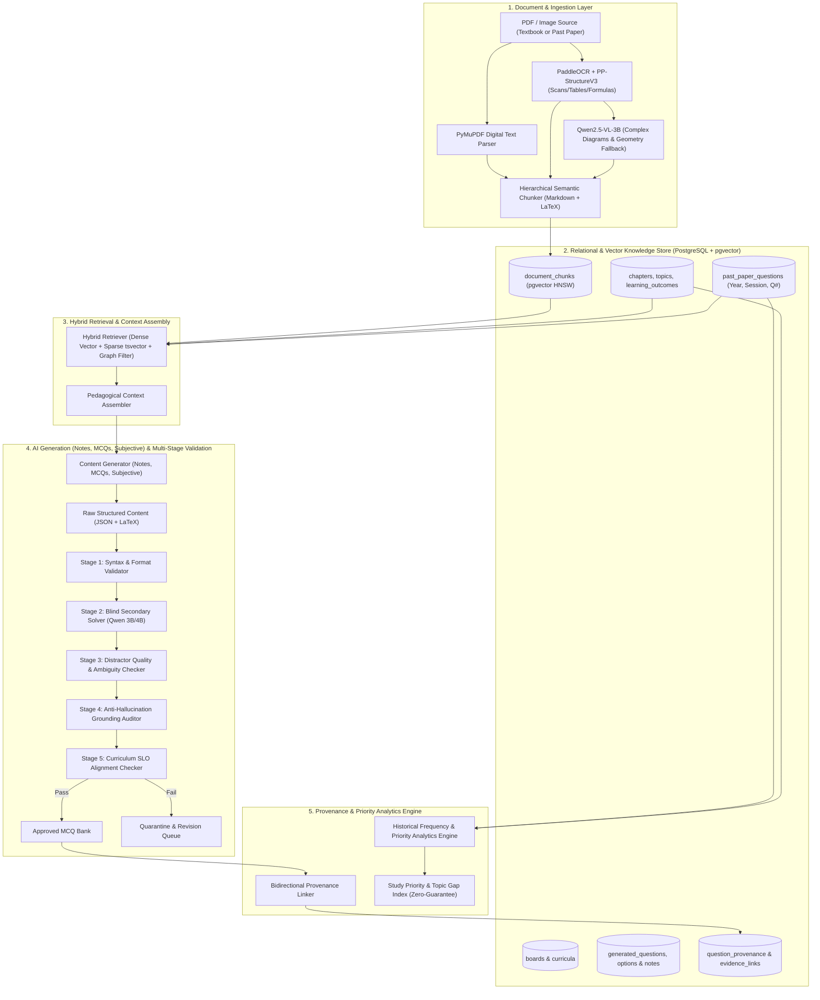
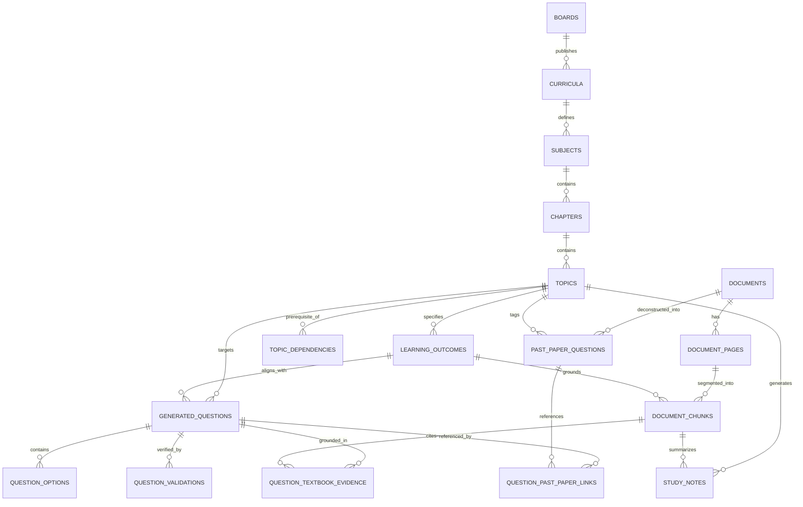
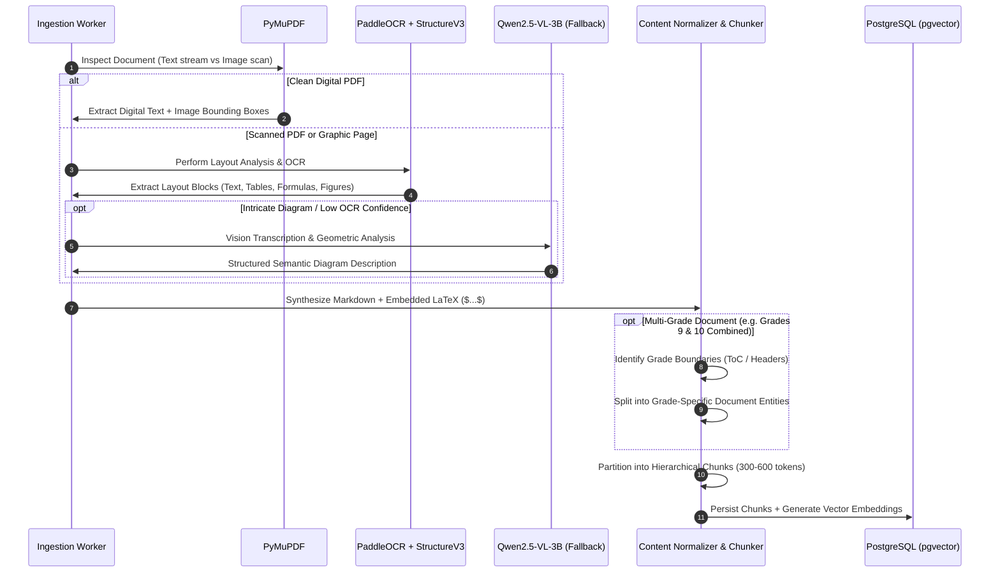
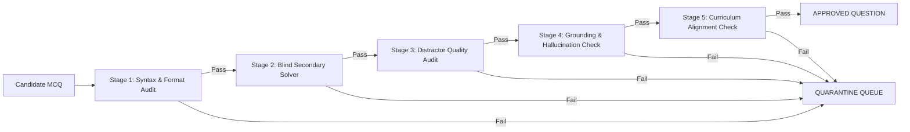
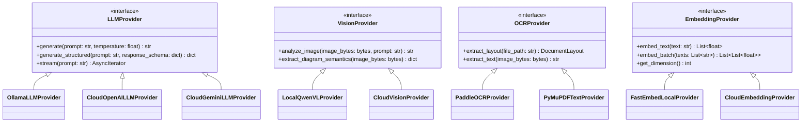

# System Architecture: AI-Powered Educational Content Engine (v1.0)

**Document Status:** Architecture Baseline  
**Target Environment:** Local Workstation (Intel Core i7-10850H, 32GB RAM, Quadro RTX 4000 8GB VRAM)  
**Primary Database:** PostgreSQL 16+ with `pgvector`  
**Execution Runtimes:** Python 3.11/3.12 (AI/Workers/FastAPI), Node.js v24 (BullMQ Task Management)  

---

## 1. Architectural Blueprint & System Topography

The platform is designed around a **hexagonal / clean architecture** pattern. The domain logic and database models are decoupled from AI inference engines, document parsing libraries, and queuing systems via strict abstraction contracts.

### 1.1 High-Level Architecture Diagram



---

## 2. Core Domain Data Model (PostgreSQL + pgvector)

The database schema is organized into four core relational clusters:
1. **Curriculum Ontology Cluster:** Boards, Curricula, Subjects, Grades, Chapters, Topics, and Student Learning Outcomes (SLOs).
2. **Document & Corpus Cluster:** Ingested Books, Past Paper series, Document Pages, and Embedded Chunks.
3. **Past Paper Catalog Cluster:** Fine-grained historical exam questions tagged with Year, Session, Paper, Question Number, and Marks.
4. **Question & Provenance Cluster:** Generated Questions (MCQs, Short/Long), Study Notes, Options, Validation Logs, Evidence Links, and Priority Metrics.

### 2.1 Entity Relationship Diagram (ERD)



### 2.2 Relational Table Specifications & DDL Schemas

#### A. Curriculum Ontology
```sql
-- Educational Boards (e.g., FBISE, Cambridge CAIE, Punjab Board)
CREATE TABLE boards (
    id UUID PRIMARY KEY DEFAULT gen_random_uuid(),
    code VARCHAR(50) UNIQUE NOT NULL,       -- e.g., 'FBISE', 'CAIE', 'PUNJAB_BOARD'
    name VARCHAR(255) NOT NULL,
    country VARCHAR(100) NOT NULL,
    jurisdiction VARCHAR(255),
    metadata JSONB DEFAULT '{}'::jsonb,
    created_at TIMESTAMPTZ DEFAULT NOW(),
    updated_at TIMESTAMPTZ DEFAULT NOW()
);

-- Curriculum Specifications (e.g., 'National Curriculum 2006', 'Cambridge 2023-2025 Syllabus')
CREATE TABLE curricula (
    id UUID PRIMARY KEY DEFAULT gen_random_uuid(),
    board_id UUID NOT NULL REFERENCES boards(id) ON DELETE CASCADE,
    code VARCHAR(100) NOT NULL,             -- e.g., 'NC-2006-SEC', 'CAIE-0625'
    title VARCHAR(255) NOT NULL,
    version_year INT NOT NULL,
    is_active BOOLEAN DEFAULT TRUE,
    created_at TIMESTAMPTZ DEFAULT NOW()
);

-- Subjects and Grades
CREATE TABLE subjects (
    id UUID PRIMARY KEY DEFAULT gen_random_uuid(),
    curriculum_id UUID NOT NULL REFERENCES curricula(id) ON DELETE CASCADE,
    code VARCHAR(50) NOT NULL,              -- e.g., 'PHY', 'CHEM', 'BIO'
    title VARCHAR(255) NOT NULL,            -- e.g., 'Physics'
    grade_level VARCHAR(50) NOT NULL,       -- e.g., 'Grade 9', 'Grade 10', 'O-Level'
    UNIQUE(curriculum_id, code, grade_level)
);

-- Chapters / Units
CREATE TABLE chapters (
    id UUID PRIMARY KEY DEFAULT gen_random_uuid(),
    subject_id UUID NOT NULL REFERENCES subjects(id) ON DELETE CASCADE,
    chapter_number INT NOT NULL,
    title VARCHAR(255) NOT NULL,
    description TEXT,
    UNIQUE(subject_id, chapter_number)
);

-- Topics & Subtopics
CREATE TABLE topics (
    id UUID PRIMARY KEY DEFAULT gen_random_uuid(),
    chapter_id UUID NOT NULL REFERENCES chapters(id) ON DELETE CASCADE,
    parent_topic_id UUID REFERENCES topics(id) ON DELETE CASCADE,
    topic_code VARCHAR(50) NOT NULL,        -- e.g., '1.3', '4.2.1'
    title VARCHAR(255) NOT NULL,
    importance_weight NUMERIC(3,2) DEFAULT 1.00
);

-- Student Learning Outcomes (SLOs) / Objectives
CREATE TABLE learning_outcomes (
    id UUID PRIMARY KEY DEFAULT gen_random_uuid(),
    topic_id UUID NOT NULL REFERENCES topics(id) ON DELETE CASCADE,
    slo_code VARCHAR(100) NOT NULL,         -- e.g., 'SLO-PHY-9-1.3.1'
    statement TEXT NOT NULL,                -- e.g., 'Explain the difference between scalar and vector quantities'
    cognitive_level VARCHAR(50) NOT NULL    -- 'Knowledge', 'Understanding', 'Application', 'Analysis'
);

-- Concept Dependency Graph
CREATE TABLE topic_dependencies (
    prerequisite_topic_id UUID NOT NULL REFERENCES topics(id) ON DELETE CASCADE,
    target_topic_id UUID NOT NULL REFERENCES topics(id) ON DELETE CASCADE,
    dependency_type VARCHAR(50) DEFAULT 'REQUIRED', -- 'REQUIRED', 'STRONGLY_RECOMMENDED', 'ANALOGOUS'
    PRIMARY KEY(prerequisite_topic_id, target_topic_id)
);
```

#### B. Document Corpus & Vector Store
```sql
CREATE EXTENSION IF NOT EXISTS "uuid-ossp";
CREATE EXTENSION IF NOT EXISTS "vector";
CREATE EXTENSION IF NOT EXISTS "pg_trgm";

-- Ingested Source Documents
CREATE TABLE documents (
    id UUID PRIMARY KEY DEFAULT gen_random_uuid(),
    board_id UUID NOT NULL REFERENCES boards(id) ON DELETE CASCADE,
    subject_id UUID REFERENCES subjects(id) ON DELETE SET NULL,
    document_type VARCHAR(50) NOT NULL,     -- 'TEXTBOOK', 'PAST_PAPER', 'SYLLABUS_DOC'
    title VARCHAR(255) NOT NULL,
    edition_year INT,
    publisher VARCHAR(255),
    file_path TEXT NOT NULL,
    file_hash_sha256 VARCHAR(64) UNIQUE NOT NULL,
    total_pages INT DEFAULT 0,
    processing_status VARCHAR(50) DEFAULT 'PENDING', -- 'PENDING', 'PROCESSING', 'COMPLETED', 'FAILED'
    metadata JSONB DEFAULT '{}'::jsonb,
    created_at TIMESTAMPTZ DEFAULT NOW()
);

-- Document Pages
CREATE TABLE document_pages (
    id UUID PRIMARY KEY DEFAULT gen_random_uuid(),
    document_id UUID NOT NULL REFERENCES documents(id) ON DELETE CASCADE,
    page_number INT NOT NULL,
    image_path TEXT,
    has_diagrams BOOLEAN DEFAULT FALSE,
    has_equations BOOLEAN DEFAULT FALSE,
    UNIQUE(document_id, page_number)
);

-- Semantic Document Chunks with Vector Embeddings
CREATE TABLE document_chunks (
    id UUID PRIMARY KEY DEFAULT gen_random_uuid(),
    document_id UUID NOT NULL REFERENCES documents(id) ON DELETE CASCADE,
    page_id UUID REFERENCES document_pages(id) ON DELETE SET NULL,
    topic_id UUID REFERENCES topics(id) ON DELETE SET NULL,
    learning_outcome_id UUID REFERENCES learning_outcomes(id) ON DELETE SET NULL,
    chunk_index INT NOT NULL,
    content TEXT NOT NULL,                  -- Markdown formatted text with embedded LaTeX ($...$)
    token_count INT NOT NULL,
    section_heading VARCHAR(255),
    embedding vector(768),                  -- Supports 768-dim dense embeddings (e.g., BGE / MiniLM / GTE)
    search_vector tsvector GENERATED ALWAYS AS (to_tsvector('english', content)) STORED,
    metadata JSONB DEFAULT '{}'::jsonb,
    created_at TIMESTAMPTZ DEFAULT NOW()
);

-- HNSW Vector Index for sub-millisecond approximate nearest neighbor retrieval
CREATE INDEX idx_document_chunks_embedding 
ON document_chunks USING hnsw (embedding vector_cosine_ops) 
WITH (m = 16, ef_construction = 64);

-- GIN Full-Text Index for sparse keyword search
CREATE INDEX idx_document_chunks_search_vector 
ON document_chunks USING gin (search_vector);
```

#### C. Historical Past-Paper Catalog
```sql
CREATE TABLE past_paper_questions (
    id UUID PRIMARY KEY DEFAULT gen_random_uuid(),
    document_id UUID NOT NULL REFERENCES documents(id) ON DELETE CASCADE,
    board_id UUID NOT NULL REFERENCES boards(id) ON DELETE CASCADE,
    subject_id UUID NOT NULL REFERENCES subjects(id) ON DELETE CASCADE,
    topic_id UUID REFERENCES topics(id) ON DELETE SET NULL,
    learning_outcome_id UUID REFERENCES learning_outcomes(id) ON DELETE SET NULL,
    
    exam_year INT NOT NULL,                 -- e.g., 2023
    exam_session VARCHAR(50) NOT NULL,      -- e.g., 'Annual-I', 'Annual-II', 'May/June'
    paper_code VARCHAR(50) NOT NULL,        -- e.g., 'Paper-1 (MCQs)', '0625/11'
    question_number INT NOT NULL,           -- e.g., 14
    sub_part VARCHAR(20),                   -- e.g., 'b(ii)'
    
    question_text TEXT NOT NULL,
    question_type VARCHAR(50) DEFAULT 'MCQ',-- 'MCQ', 'SHORT_DESCRIPTIVE', 'NUMERICAL'
    options JSONB,                          -- Optional: [{"label": "A", "text": "..."}, ...]
    correct_key VARCHAR(10),                -- 'A', 'B', 'C', 'D' if known from marking scheme
    marks INT DEFAULT 1,
    cognitive_level VARCHAR(50),
    has_figure BOOLEAN DEFAULT FALSE,
    figure_asset_path TEXT,
    raw_ocr_metadata JSONB DEFAULT '{}'::jsonb,
    created_at TIMESTAMPTZ DEFAULT NOW(),
    UNIQUE(board_id, subject_id, exam_year, exam_session, paper_code, question_number, sub_part)
);

CREATE INDEX idx_past_paper_lookup ON past_paper_questions(board_id, subject_id, exam_year);
CREATE INDEX idx_past_paper_topic ON past_paper_questions(topic_id);
```

#### D. Generated Content (Notes & Questions) & Provenance Graph
```sql
CREATE TABLE study_notes (
    id UUID PRIMARY KEY DEFAULT gen_random_uuid(),
    topic_id UUID NOT NULL REFERENCES topics(id) ON DELETE CASCADE,
    title VARCHAR(255) NOT NULL,
    content TEXT NOT NULL,                  -- Markdown formatted summary preserving LaTeX and layouts
    created_at TIMESTAMPTZ DEFAULT NOW()
);

CREATE TABLE generated_questions (
    id UUID PRIMARY KEY DEFAULT gen_random_uuid(),
    topic_id UUID NOT NULL REFERENCES topics(id) ON DELETE CASCADE,
    learning_outcome_id UUID NOT NULL REFERENCES learning_outcomes(id) ON DELETE CASCADE,
    
    question_type VARCHAR(50) NOT NULL,     -- 'MCQ', 'SHORT_DESCRIPTIVE', 'NUMERICAL', 'LONG_DESCRIPTIVE'
    stem TEXT NOT NULL,                     -- Question prompt formatted in Markdown & LaTeX
    context_hint TEXT,
    difficulty_level VARCHAR(20) NOT NULL,  -- 'EASY', 'MEDIUM', 'HARD'
    cognitive_level VARCHAR(50) NOT NULL,   -- 'Knowledge', 'Understanding', 'Application'
    
    diagram_asset_path TEXT,
    is_equation_heavy BOOLEAN DEFAULT FALSE,
    
    validation_status VARCHAR(50) DEFAULT 'PENDING_VALIDATION', -- 'APPROVED', 'REJECTED', 'QUARANTINE'
    quality_score NUMERIC(3,2),             -- Score 0.00 to 1.00 assigned by validation gauntlet
    rejection_reason TEXT,
    
    generated_by_model VARCHAR(100) NOT NULL,
    generation_prompt_hash VARCHAR(64),
    created_at TIMESTAMPTZ DEFAULT NOW()
);

-- Options (Required for MCQs)
CREATE TABLE question_options (
    id UUID PRIMARY KEY DEFAULT gen_random_uuid(),
    question_id UUID NOT NULL REFERENCES generated_questions(id) ON DELETE CASCADE,
    option_label CHAR(1) NOT NULL,          -- 'A', 'B', 'C', 'D'
    option_text TEXT NOT NULL,              -- Markdown / LaTeX content
    is_correct BOOLEAN NOT NULL DEFAULT FALSE,
    explanation TEXT NOT NULL,              -- Pedagogical reason why this option is correct/incorrect
    misconception_tag VARCHAR(255),         -- Description of the underlying cognitive trap
    UNIQUE(question_id, option_label)
);

-- Automated Validation Audit Trail
CREATE TABLE question_validations (
    id UUID PRIMARY KEY DEFAULT gen_random_uuid(),
    question_id UUID NOT NULL REFERENCES generated_questions(id) ON DELETE CASCADE,
    validator_stage VARCHAR(100) NOT NULL,  -- 'SYNTAX_CHECK', 'BLIND_SOLVER', 'QUALITY_AUDIT', 'GROUNDING_CHECK'
    validator_model VARCHAR(100) NOT NULL,
    passed BOOLEAN NOT NULL,
    details JSONB NOT NULL,
    created_at TIMESTAMPTZ DEFAULT NOW()
);

-- Provenance Link 1: Source Textbook Evidence
CREATE TABLE question_textbook_evidence (
    id UUID PRIMARY KEY DEFAULT gen_random_uuid(),
    question_id UUID NOT NULL REFERENCES generated_questions(id) ON DELETE CASCADE,
    chunk_id UUID NOT NULL REFERENCES document_chunks(id) ON DELETE RESTRICT,
    relevance_score NUMERIC(4,3) NOT NULL,
    verbatim_quote TEXT NOT NULL,           -- Exact sentence/formula justifying the correct answer/note
    page_number INT NOT NULL,
    created_at TIMESTAMPTZ DEFAULT NOW()
);

-- Provenance Link 2: Historical Past-Paper Precedents
CREATE TABLE question_past_paper_links (
    id UUID PRIMARY KEY DEFAULT gen_random_uuid(),
    question_id UUID NOT NULL REFERENCES generated_questions(id) ON DELETE CASCADE,
    past_paper_question_id UUID NOT NULL REFERENCES past_paper_questions(id) ON DELETE CASCADE,
    similarity_score NUMERIC(4,3) NOT NULL,
    relationship_type VARCHAR(50) NOT NULL, -- 'IDENTICAL_CONCEPT', 'NUMERICAL_VARIANT', 'PARAPHRASED_STEM'
    created_at TIMESTAMPTZ DEFAULT NOW()
);
```

---

## 3. Ingestion & Document Processing Pipeline

Ingesting complex scientific textbooks and past examination papers requires a multi-layered extraction strategy capable of handling dense prose, mathematical notations, multi-column layouts, tables, and illustrative diagrams.



### Ingestion Components
1. **PyMuPDF (`fitz`):** Primary fast extractor for native digital text PDFs. Extracts raw Unicode, font characteristics (to identify chapter/section headings by font size), and vector images.
2. **PaddleOCR & PP-StructureV3:** High-precision layout analysis tool. Automatically classifies bounding boxes into `title`, `text`, `table`, `formula`, and `figure`. Converts tables into structured Markdown and formulas into standard $\LaTeX$.
3. **Multi-Grade Partitioner:** A dedicated heuristic/LLM step that scans the Table of Contents or large section headers to split combined syllabus/resource documents (e.g. "Grade 9 & 10") into separate, grade-specific context streams before chunking.
4. **Qwen2.5-VL-3B (Vision Fallback):** Invoked conditionally when:
   - A past paper or textbook page contains an unlabeled circuit diagram, biological diagram, or coordinate graph.
   - PaddleOCR formula confidence score drops below 0.85.
   - Visual transcription generates a semantic summary of the figure (e.g., *"A circuit with two resistors $R_1=4\Omega$ and $R_2=6\Omega$ connected in parallel across a $12\text{V}$ DC source"*).

---

## 4. Hybrid Retrieval Engine (RAG)

Standard vector search alone is inadequate for educational syllabus matching because mathematical questions frequently share dense semantic space while testing distinct algebraic concepts. The platform implements a **Tri-Fold Hybrid Retrieval Pipeline**:

```
           +-------------------------------------------------------------+
           |                    TARGET TOPIC / SLO                       |
           +-------------------------------------------------------------+
                                          |
                   +----------------------+----------------------+
                   |                                             |
                   v                                             v
        [ Dense Vector Search ]                       [ Sparse Keyword Search ]
        pgvector HNSW Cosine                          PostgreSQL tsvector (BM25)
        (Captures semantic intent)                    (Captures exact terms & symbols)
                   |                                             |
                   +----------------------+----------------------+
                                          |
                                          v
                         [ Reciprocal Rank Fusion (RRF) ]
                                          |
                                          v
                      [ Curriculum Knowledge Graph Filter ]
                      - Must match Board ID
                      - Must match Grade Level
                      - Must match Target Chapter/Topic
                      - Filter out-of-syllabus concepts
                                          |
                                          v
                      [ Historical Past Paper Precedent Join ]
                      Fetch top-k historically relevant exam questions
                                          |
                                          v
                         [ Final Assembled Context Window ]
```

---

## 5. MCQ Generation & Pedagogy Engine

### 5.1 The Anatomy of an Educational MCQ
Every generated question must strictly avoid common generation flaws (e.g., "all of the above", trivial distractors, grammatical giveaways).

```
+-----------------------------------------------------------------------------------------+
| [STEM]                                                                                  |
| A clear, unambiguous problem statement containing all necessary conditions.             |
| Includes LaTeX formulas or diagram reference when applicable.                           |
+-----------------------------------------------------------------------------------------+
| [OPTION A] Distractor: Based on Common Student Misconception #1 (e.g. inverted formula) |
+-----------------------------------------------------------------------------------------+
| [OPTION B] Key (Correct): Verified against textbook evidence chunk.                     |
+-----------------------------------------------------------------------------------------+
| [OPTION C] Distractor: Based on Misconception #2 (e.g. sign error / scalar vs vector)   |
+-----------------------------------------------------------------------------------------+
| [OPTION D] Distractor: Based on Misconception #3 (e.g. unit mismatch)                   |
+-----------------------------------------------------------------------------------------+
| [EXPLANATION] Step-by-step resolution proving B is correct and diagnosing A, C, D.      |
+-----------------------------------------------------------------------------------------+
```

### 5.2 Supported Archetypes
1. **Recall & Conceptual Definition:** Testing exact scientific terminology and principles.
2. **Computational / Equation Application:** Testing quantitative calculations with embedded LaTeX.
3. **Diagrammatic / Visual Interpretation:** Interpreting graphs (e.g., Velocity-Time graphs) or system diagrams.
4. **Assertion-Reasoning:** Evaluating two interrelated statements ($A$ and $R$) to determine whether $R$ is the correct explanation of $A$.

---

## 6. Multi-Stage Automated Validation Pipeline ("The Gatekeeper")

No question is written to the approved question bank without traversing a **5-stage automated verification gauntlet**:



### Detailed Validation Stages

| Stage | Name | Evaluation Mechanism | Pass Criteria |
| :---: | :--- | :--- | :--- |
| **1** | **Syntax & Formula Audit** | Regex / Pydantic Parser | Valid JSON; Exactly 4 options (`A, B, C, D`); Valid LaTeX syntax (compiles with KaTeX/MathJax); No markdown syntax errors. |
| **2** | **Blind Secondary Solver** | Independent Model (Qwen 3B/4B) | The secondary model is provided *only* the stem and options (no correct key or explanation). It must independently arrive at the exact designated correct key with confidence $>0.90$. If the solver chooses a distractor or declares ambiguity, the question is **immediately rejected**. |
| **3** | **Distractor & Bias Audit** | Heuristic Rules & LLM Evaluator | Option lengths are balanced; No "All of the above" or "None of the above"; No mutually exclusive option pairs that reveal the key; Distractors represent documented misconceptions. |
| **4** | **Source Grounding Audit** | LLM NLI (Natural Language Inference) | Verifies that every assertion made in the stem and correct option is logically entailed by the retrieved source textbook chunk. Any extra-curricular knowledge results in quarantine. |
| **5** | **Curriculum SLO Alignment** | Taxonomy Classifier | Confirms the question directly assesses the target Student Learning Outcome (SLO) at the designated cognitive level (Knowledge, Understanding, or Application). |

---

## 7. Dual Provenance & Historical Citation Architecture

Every approved MCQ possesses an immutable, bidirectional audit trail:

```
                      +---------------------------------------+
                      |             APPROVED MCQ              |
                      +---------------------------------------+
                                  /               \
                                 /                 \
                                v                   v
               [ TEXTBOOK EVIDENCE ]             [ PAST PAPER PRECEDENTS ]
               - Book ID & Title                 - Board Name: FBISE
               - Edition: 2024                   - Year: 2023
               - Chapter 3: Dynamics             - Session: Annual-I
               - Page: 67                        - Paper: Physics SSC-I (MCQs)
               - Chunk ID: c7a9f-44              - Question No: Q1(viii)
               - Verbatim Evidence:              - Historical Question Text
                 "Momentum is defined as the     - Match Type: IDENTICAL_CONCEPT
                  product of mass and velocity."
```

---

## 8. Study Priority Engine (The Historical Frequency Index)

### 8.1 Mathematical Priority Formula
To prioritize study topics and candidate questions without violating ethical educational principles, the engine implements the **Historical Frequency & Coverage Index (HFCI)**:

$$\text{HFCI}(T) = w_f \cdot F_{\text{norm}}(T) + w_r \cdot R(T) + w_c \cdot C(T) + w_s \cdot S(T)$$

Where:
- $F_{\text{norm}}(T) \in [0, 1]$: Normalized frequency of topic $T$ across historical past papers in the selected examination window (e.g., past 5–10 years).
- $R(T) = \sum_{y \in \text{Years}} e^{-\lambda(Y_{\text{current}} - y)}$: Exponential recency-weighted appearance score ($\lambda \approx 0.15$).
- $C(T) \in [0, 1]$: Cognitive weight assigned in the formal curriculum framework (e.g., SLO allocation).
- $S(T) \in [0, 1]$: Textbook coverage density (chunk volume / exercise ratio).
- Recommended default weights: $w_f = 0.40, w_r = 0.25, w_c = 0.20, w_s = 0.15$.

### 8.2 Ethical Guardrails & Disclaimer Enforcement
The priority engine enforces strict output policies:
1. **Forbidden Terms in Prompts and UI:** `guaranteed`, `leaked`, `sure-shot`, `100% test question`, `exam predictor`.
2. **Standard Terminology:** `High Historical Frequency Topic`, `Core Syllabus Learning Outcome`, `Frequent Examination Pattern`.
3. **Mandatory Persistent Disclaimer:**
   > *"Educational Notice: Priority rankings are derived strictly from historical past-paper frequency and curriculum learning outcome distributions. Examination boards retain complete autonomy over paper setting. No topic or question is ever guaranteed to appear on any examination."*

---

## 9. AI Provider Abstraction Layer (Hexagonal Interfaces)

To maintain absolute independence from any single model or commercial provider, all AI interactions are isolated behind abstract interfaces. Local open-weight models (Qwen via Ollama) and cloud models (OpenAI, Anthropic, Google Gemini) implement identical contracts.



### Python Interface Specifications (`app/core/providers/`)
```python
from abc import ABC, abstractmethod
from typing import List, Dict, Any, Optional

class LLMProvider(ABC):
    @abstractmethod
    async def generate(self, prompt: str, system_prompt: Optional[str] = None, temperature: float = 0.2) -> str:
        """Generate unstructured text response."""
        pass

    @abstractmethod
    async def generate_structured(self, prompt: str, schema: Dict[str, Any], system_prompt: Optional[str] = None) -> Dict[str, Any]:
        """Generate strictly formatted JSON conforming to the supplied JSON schema."""
        pass

class VisionProvider(ABC):
    @abstractmethod
    async def extract_diagram_semantics(self, image_path: str, context_prompt: str) -> Dict[str, Any]:
        """Extract semantic objects, relationships, and values from educational figures."""
        pass

class OCRProvider(ABC):
    @abstractmethod
    async def process_document_page(self, page_image_path: str) -> Dict[str, Any]:
        """Extract text blocks, tables, and mathematical formulas in Markdown/LaTeX format."""
        pass

class EmbeddingProvider(ABC):
    @abstractmethod
    async def embed_query(self, text: str) -> List[float]:
        """Generate dense vector for retrieval query."""
        pass

    @abstractmethod
    async def embed_documents(self, texts: List[str]) -> List[List[float]]:
        """Batch embedding generation for document chunks."""
        pass

    @property
    @abstractmethod
    def dimension(self) -> int:
        """Return vector dimension (e.g., 768 or 1536)."""
        pass
```

---

## 10. Asynchronous Task Queue & Execution Engine

Due to the workstation's 8 GB VRAM budget, concurrent model execution is prevented by orchestrating workloads into discrete, sequential job queues managed by **Redis** and **BullMQ / Python Task Workers**:

```
+-------------------------------------------------------------------------------+
|                             TASK QUEUES (REDIS)                               |
+-------------------------------------------------------------------------------+
| Queue 1: Ingestion Queue     -> PaddleOCR / Layout (CPU or GPU batch)         |
| Queue 2: Embedding Queue     -> FastEmbed / BGE (CPU / lightweight GPU)       |
| Queue 3: Generation Queue    -> Qwen 8B (Allocates 6.5 GB VRAM)               |
| Queue 4: Validation Queue    -> Qwen 3B/4B Blind Solver (Allocates 3.5 GB VRAM)|
| Queue 5: Analytics Queue     -> HFCI Priority Calculation (PostgreSQL SQL)   |
+-------------------------------------------------------------------------------+
```

Workers process batches sequentially with model swapping managed automatically via Ollama's model unloading protocol, guaranteeing zero Out-Of-Memory interruptions.
