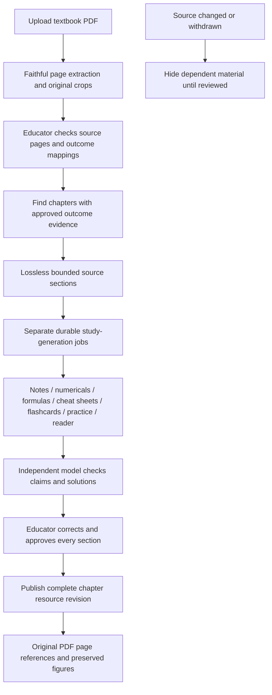

# One source-backed study library

The product should connect a student's syllabus outcome to an explanation, a worked example, original evidence and a way to practise. A large pile of AI-generated files does not establish that connection or academic quality.

## Implemented workflow

- `/upload`: textbook uploads can request an automatic study pack after source approval. Other document types do not create textbook resources.
- `/admin/knowledge`: approving the last source page schedules all seven resource types for chapters with reviewed mappings. Empty or unsupported curriculum mappings remain a review issue; they are not fabricated.
- `/admin/study`: choose a book, chapters and resource types; inspect deferred/failed jobs; edit structured draft blocks; compare original pages; record publication or withdrawal decisions. Repeated requests do not duplicate existing revisions.
- `/study`: filter by board, class, subject and resource type. Only published, current-syllabus material with valid approved citations appears.
- `/study/[id]`: readable chapter sections, explicit coverage, original figures, worked answers, revealable flashcards/practice solutions and browser print/save-PDF. This creates an accessible reading layout, not a silently altered replacement for the original textbook PDF.

## Data design

The existing `StudyNote` model is extended instead of introducing another parallel notes table. Its `kind` describes the learning resource; `sourceDocumentId`, `topicId` and `syllabusVersionId` describe academic scope. Composite foreign keys enforce source/version and chapter/version consistency. `revision`, `partIndex` and `partTotal` describe a complete chapter-resource edition.

`StudyNoteSource` contains normalized citations to `KnowledgeArtifact` and the exact reviewed content hashes. Draft blocks contain only references to those approved pages and valid chapter outcomes. Public reads and publication both revalidate the source state, hashes and syllabus. Database constraints require a reviewer, review timestamp, review note and content hash for source-backed published resources.

Source text is partitioned without discarding characters; slices retain page IDs, character offsets and hashes. One generation job reads only its assigned pages. Large books therefore do not get loaded in full for every note request. Individual jobs can defer for provider capacity while assessment workers continue independently.

All sections in a chapter-resource revision must be published before it becomes student-visible. The prior complete revision remains available until the replacement is complete. A later review cannot replace a newer published revision with an older draft. Revisions and audit records are retained.

## Official material and generated material

Original syllabuses, past papers and board model papers remain source documents. A book cannot establish a new official syllabus, exam date, paper pattern or past-paper history. Generated questions and papers must be labelled practice or exam-style material. Official archives are linked through the existing board/class/subject pages; source-backed paper/curriculum activation still requires its own reviewed workflow.

## Verification

The test suite covers source approval prerequisites, concurrent scheduling, fake citations, administrator authorization, stale reviews, source withdrawal, scope foreign keys and complete multipart publication. Partition tests reconstruct every source character, including unusually long lines. Scientific text tests verify that punctuation and chemical notation are preserved and source HTML cannot execute.

A live Gemini rehearsal generated all seven resource types from the synthetic constant-mass example `F = ma`, `2 kg × 3 m/s² = 6 N`. Independent checks reported agreement; every output remained `PENDING_REVIEW`. The record is in `docs/verification/STUDY-LIBRARY-REHEARSAL-2026-10-21.json`. This is a small integration fixture, not a scientific evaluation of arbitrary textbooks.

## Next product improvements

1. **Syllabus coverage map:** show which outcomes have approved book pages, notes, numericals and past-paper questions; distinguish uncovered material from a student's weak performance.
2. **Mistake notebook:** connect actual wrong quiz answers to explanations, source pages and the exact misconception. Let students retry without overwriting their first score.
3. **Spaced repetition:** schedule reviewed flashcards by recall history, with a daily mobile queue and a clear due count.
4. **Revision planner:** combine exam dates supplied by the student, available study time and measured weak topics. Explain why a chapter is recommended.
5. **Past-paper explorer:** filter original questions by year, paper, chapter, outcome, marks and cognitive demand. Keep provenance and answer-key review visible.
6. **Teacher study collections:** assign a chapter reader, selected notes and a quiz together; show completion and topic-level progress within existing classroom permissions.
7. **Low-bandwidth reading:** cache explicitly selected published packs for offline use, with version dates and a refresh warning when source material changes.
8. **Student feedback loop:** report a questionable step or diagram against a specific source reference. Reviewers can withdraw the affected resource while checking it.

These are planned extensions, not claims that they are all activated. Existing published content still needs academic recertification. Generative colorful diagram derivatives, an external MCP integration and long-page vector chunks remain separate from this release. Original diagrams stay authoritative.

## Release configuration

Apply the two additive study migrations after a fresh backup and preflight. Update the private AI worker's `WORKER_KINDS` to include `STUDY_GENERATION`; keep its existing resource/connection limits. Web admission checks require a recent worker heartbeat for manual study generation. New provider or storage access is not required. The public library remains empty until an educator publishes reviewed resources; rehearsal content belongs only to the test database.
